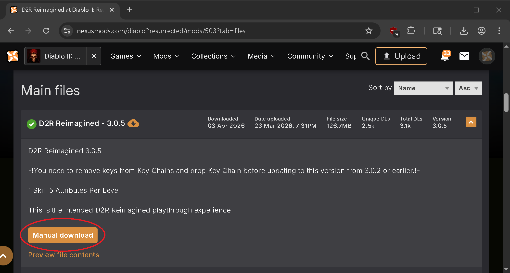
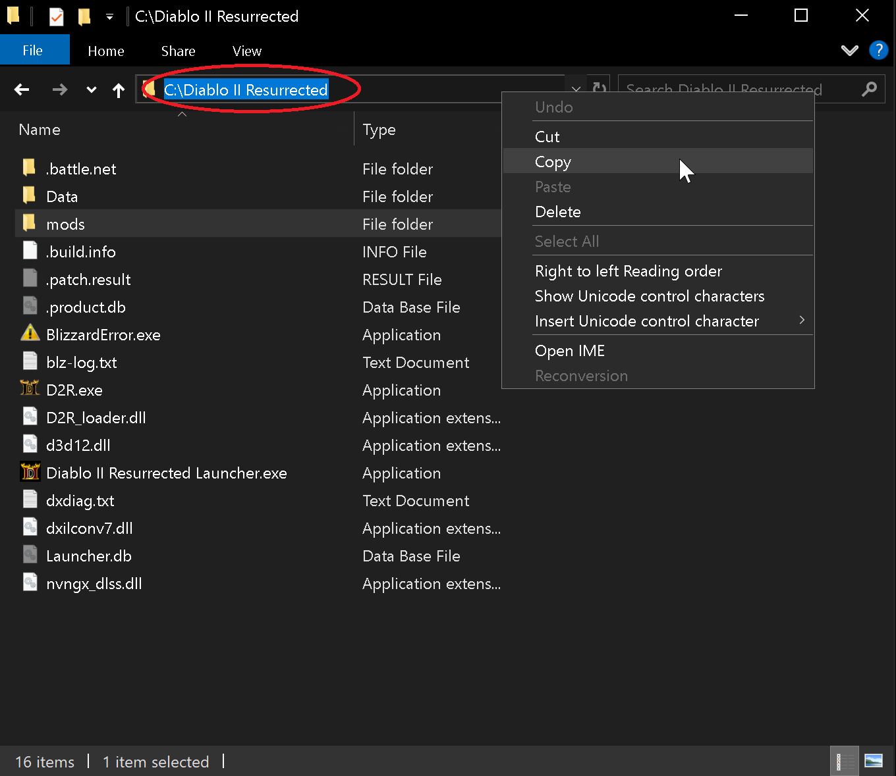
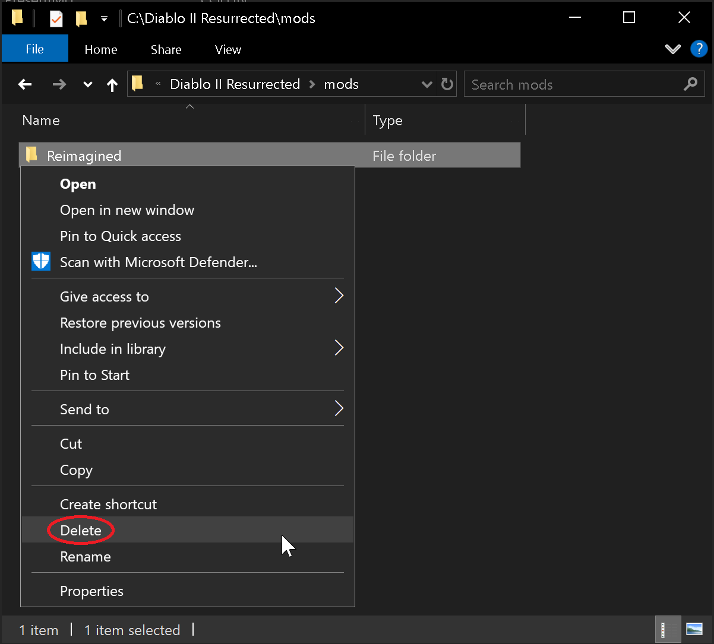
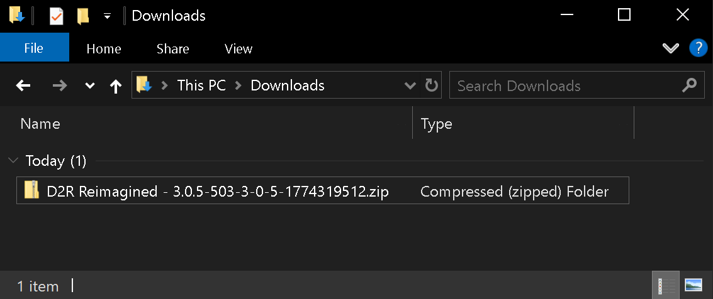
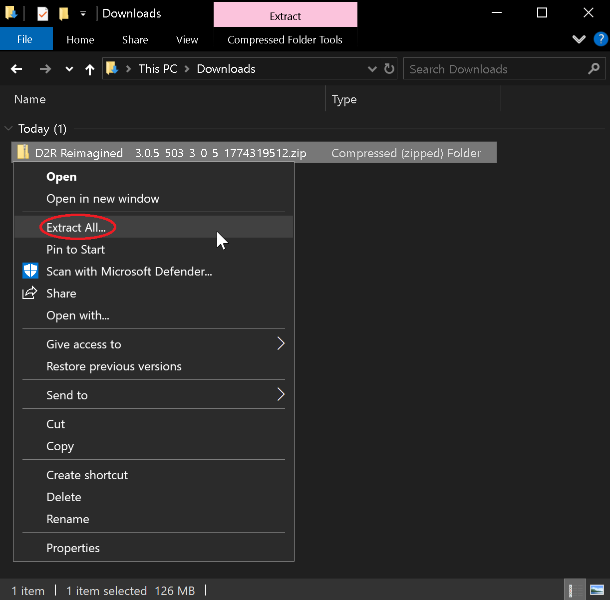
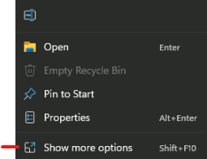
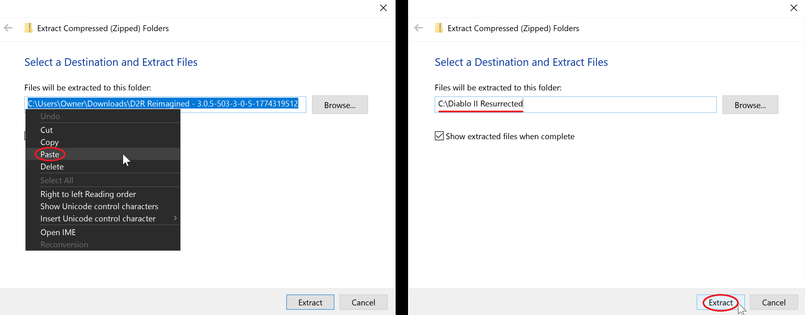
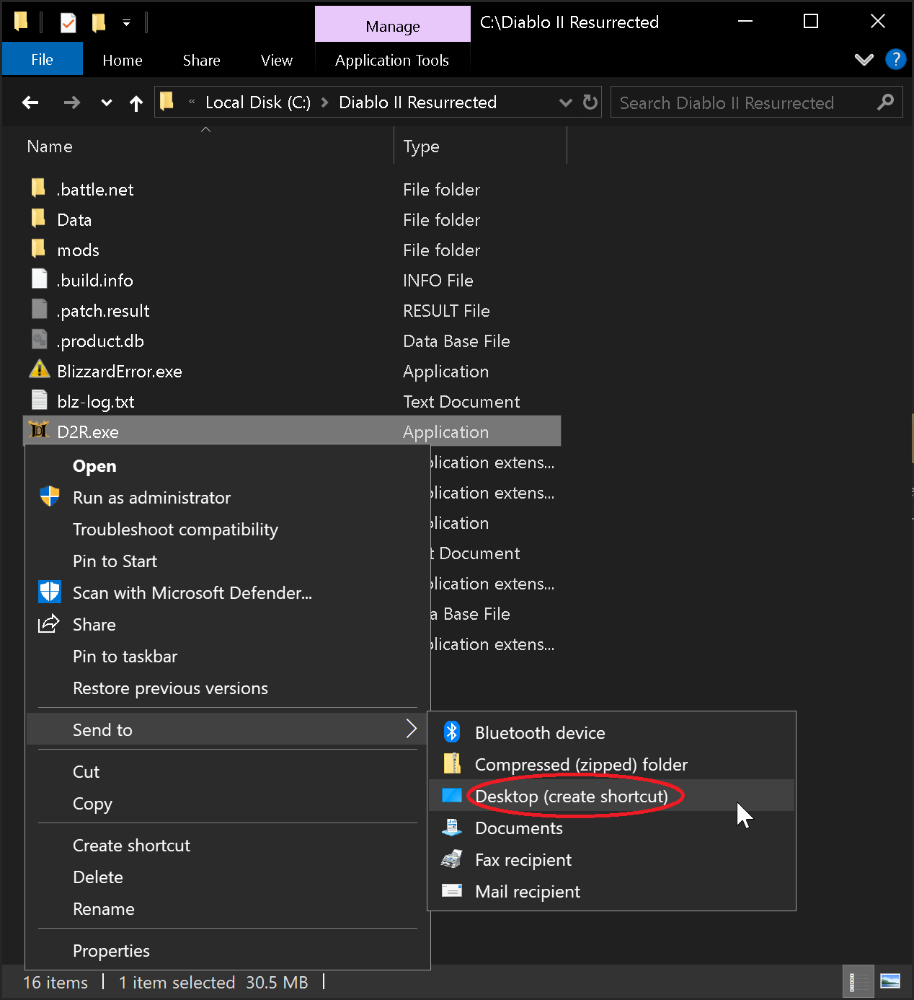
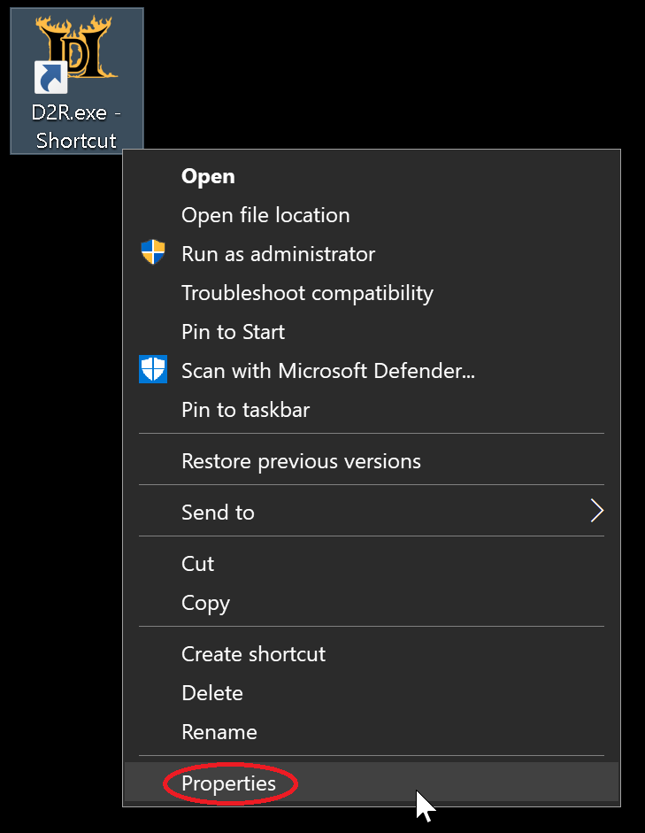
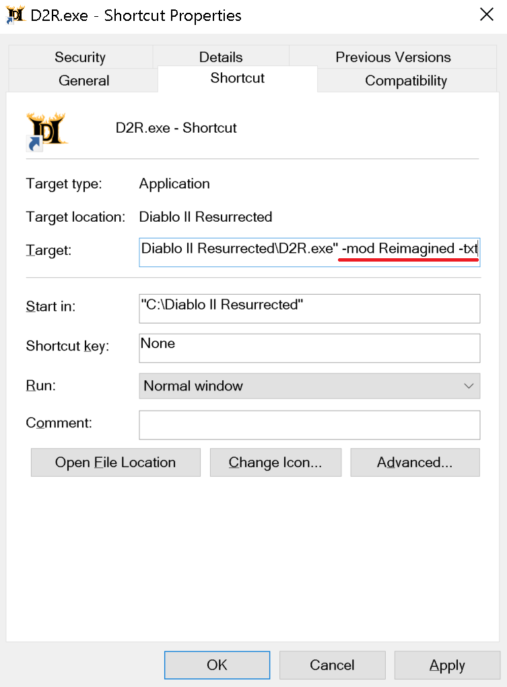

## Manual Reimagined Mod Installation

_Instructions to install the Reimagined mod manually without using any launchers or assistive programs._

Step 1. Download the latest Reimagined Mod version from [Nexus Mods](https://www.nexusmods.com/diablo2resurrected/mods/503?tab=files).

Step 2. Navigate to your [D2R Installation Directory](https://wiki.d2r-reimagined.com/en/Installs#file-locations) and at the top left click in the blank space and right click to highlight the game's path.  Then right click & click `Copy` as this information will be used in the step 4.  Next `open` the folder called "*mods*".  Your game's installed location will be different then in the picture.  

Step 3. Inside the mods folder check for a previous Reimagined folder & if present `delete` it since you're about to install a new version. (*right click, delete*)

Step 4. Navigate to where you just downloaded the mod, by default files typically go into your “*Downloads*” folder.  The new ZIP file that you just downloaded starts with the name: "D2R Reimagined" followed by a version number should be located here.  The picture below shows Reimagined version 3.0.5 as an example.

Step 5. Right click the ZIP file & click `Extract All` 

-   *Windows11 Users Click* `*Show More Options*` *to complete the above step.*

Step 6. On this next box that pops right click the pathway & click `Paste`.  Now the destination should be where you were earlier when you copied the path.  Again your location will be different then the one in the picture below.   Now click the `Extract` button and the Reimagined mod is now fully installed!

Step 7. Next we'll create a shortcut you can use to launch the mod.  Go back to your game's installation (from Step 2) & Right click on D2R.exe and click `Send to` and then `Desktop (Create Shortcut)`

-   *W11 Users Click* `*Show More Options*` *to complete the above step.*

-   Right click the shortcut on the desktop and select `Properties`

-   In the Target field, add the following to the end of the field:
    -   ` -mod Reimagined -txt`
    -   ` -mod Reimagined -txt -resetofflinemaps` *(_OPTIONAL:_ This will reset your maps everytime you visit the character select screen)*

-   **Make sure there's a space in-between D2R.exe" and -mod**
-   Click `Apply` and then `OK`

Step 6. You can rename the shortcut to anything and then Click or Double-Click the shortcut to play the mod.  Reimagined is now Installed and ready!

**If you wish to manually install any of the 6 Customization Tweaks (2skill, Forced Terror Zones, RemoveAuraSounds, HDR Fix, Letterbox removal, splashcharm graphic removal) those files are also included inside the Beta Launchers ZIP file towards the top of this page for players that are manually installing their game.  If you only want the 2Skill file, then just download the next file below instead.**