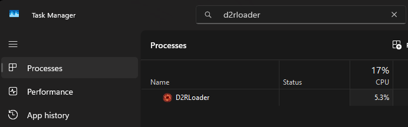
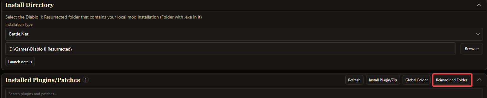
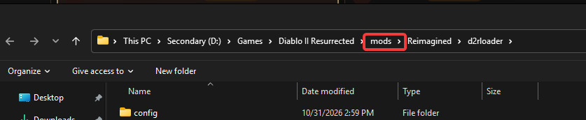
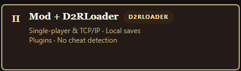
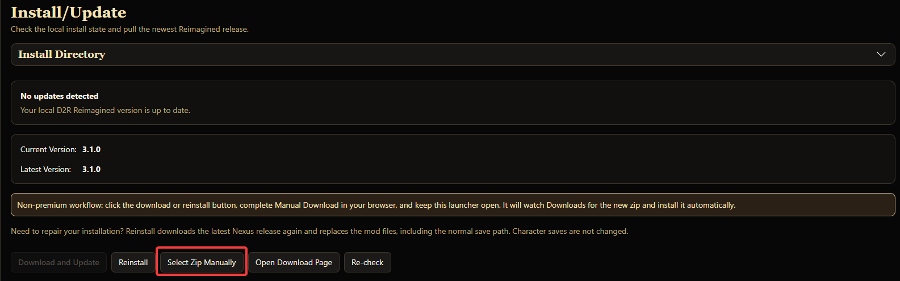
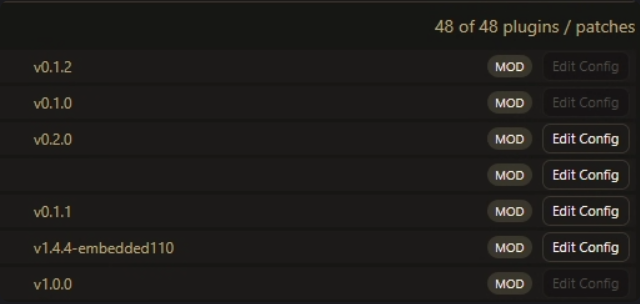

# Installing The Ladder Plugin Package
>  This guide assumes you have installed the D2R Reimagined Launcher already

## Prep

- We first need to sanitize our setup to create a consistent environment for plugin install.

- Find and kill D2RLoader.exe in task manager if it is currently open

- Manually delete the {D2InstallFolder}/mods/Reimagined folder, this should help ensure that plugins install with the package without extra steps. 
- You can find this more easily by clicking the Reimagined Folder button in the launcher and clicking the mods button in the folder path.

- Select Launcher option 2, install D2RLoader if you have not already via the prompt

## Installing the Ladder plugin package

- Get the D2R.Reimagined.Loader zip file from the most recent release from [Github](https://github.com/D2R-Reimagined/d2r-reimagined-mod/releases). For 3.1 this is located [here](https://github.com/D2R-Reimagined/d2r-reimagined-mod/releases/tag/3.1.0).

- In the launcher, navigate to the Install/Update panel, and click the Select Zip Manually button

- Select the zip you downloaded from Github. This should install the mod files as well as any plugins included in the zip.
- Your plugins section of the launcher should look as below, specifically as mod installs rather than global. See notes below about global installs if you think they are relevant to you.

## Troubleshooting and Notes

### If your plugins list is empty, or is missing key Reimagined specific plugins like Maps

- Open the zip file and copy the mods folder over top of your existing one in your D2R Install directory.
-- If you're more familiar with filesystems, you can just copy the d2rloader folder into the mods\Reimagined\D2RLoader folder directly for only plugins/patches. You may need to delete/replace configs in certain niche cases.

### Global Plugins

- Some plugins can be moved to the global context (D2InstallFolder/D2RLoader/plugins) if you play multiple mods and would like to use the same plugins between multiple, but this guide will not detail specifics. You will need to use trial and error, along with the extensions tab in the main menu settings cog to determine which can run in this context.

- Some plugins (like Pyre Loot Filter, for example) cannot run in a global context.

- Updating plugins from the zip distribution is a little more difficult if you decide to install any in a global context.

### Updating Plugins

- Currently the launcher cannot update plugins automatically, nor will selecting a zip manually install the plugins in the package over top of your existing setup. 

- To update plugins, you can download the new zip file from Github and manually copy the mod folder again, or simply copy the plugins folder. 
> This *can* cause conflicts with other plugins you have installed from outside of the ladder package.
{.is-warning}

