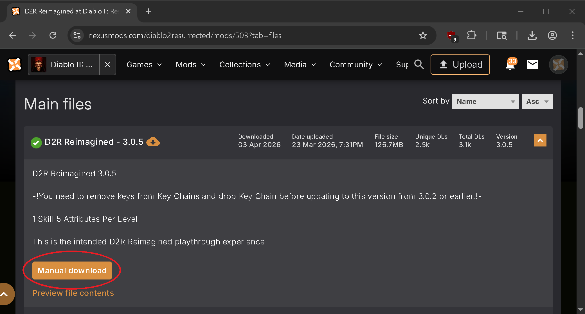
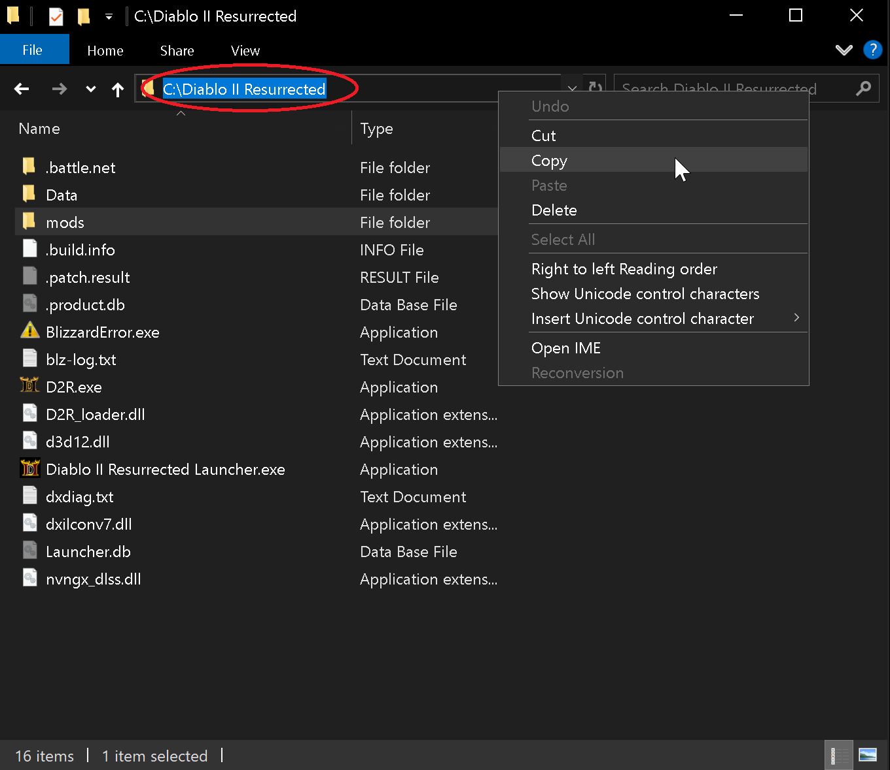
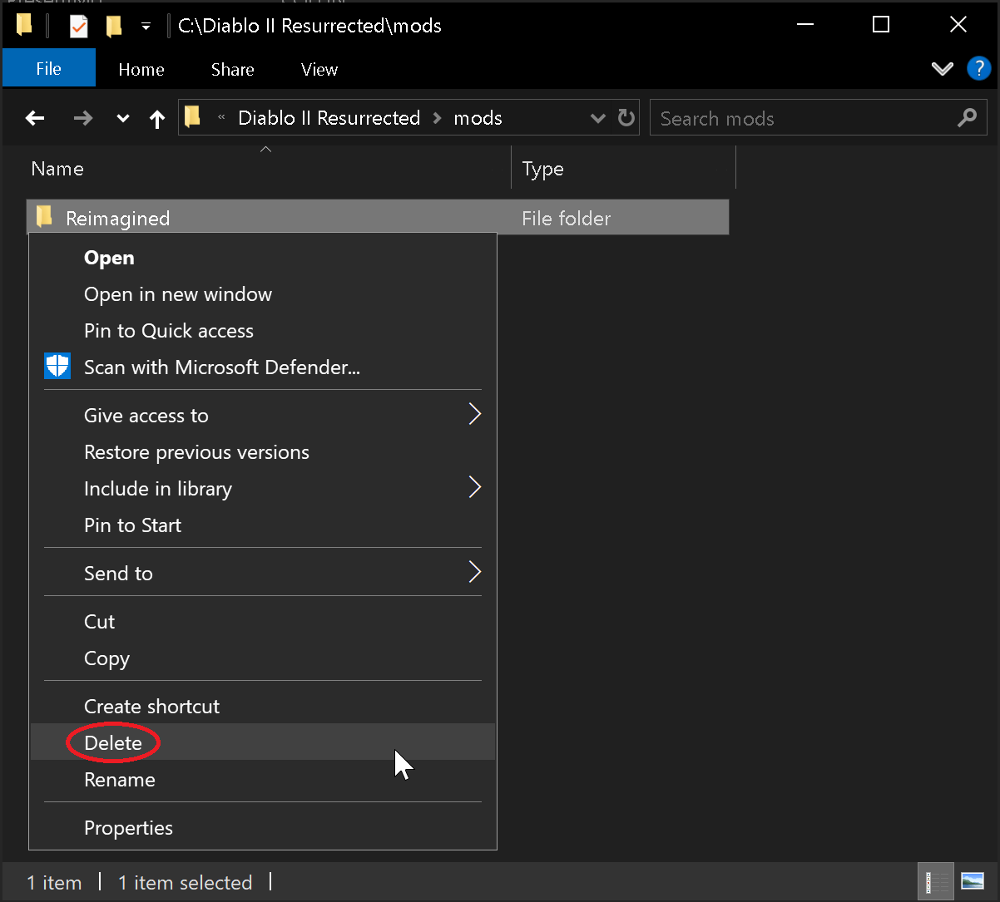
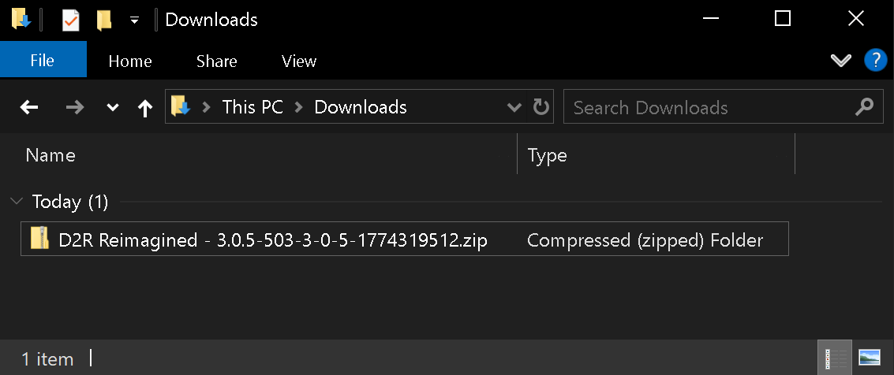
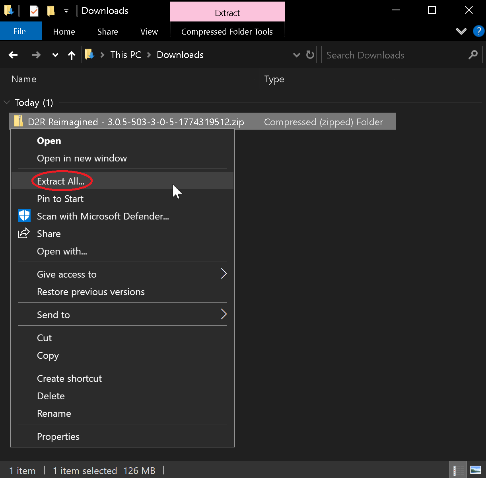
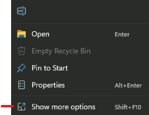
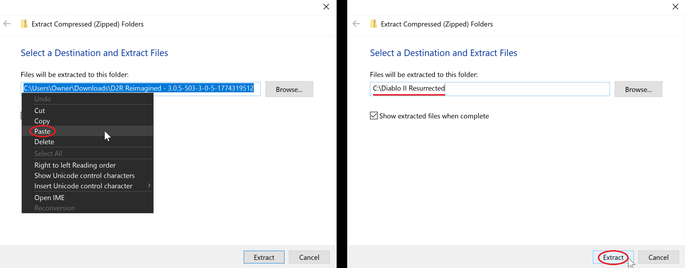
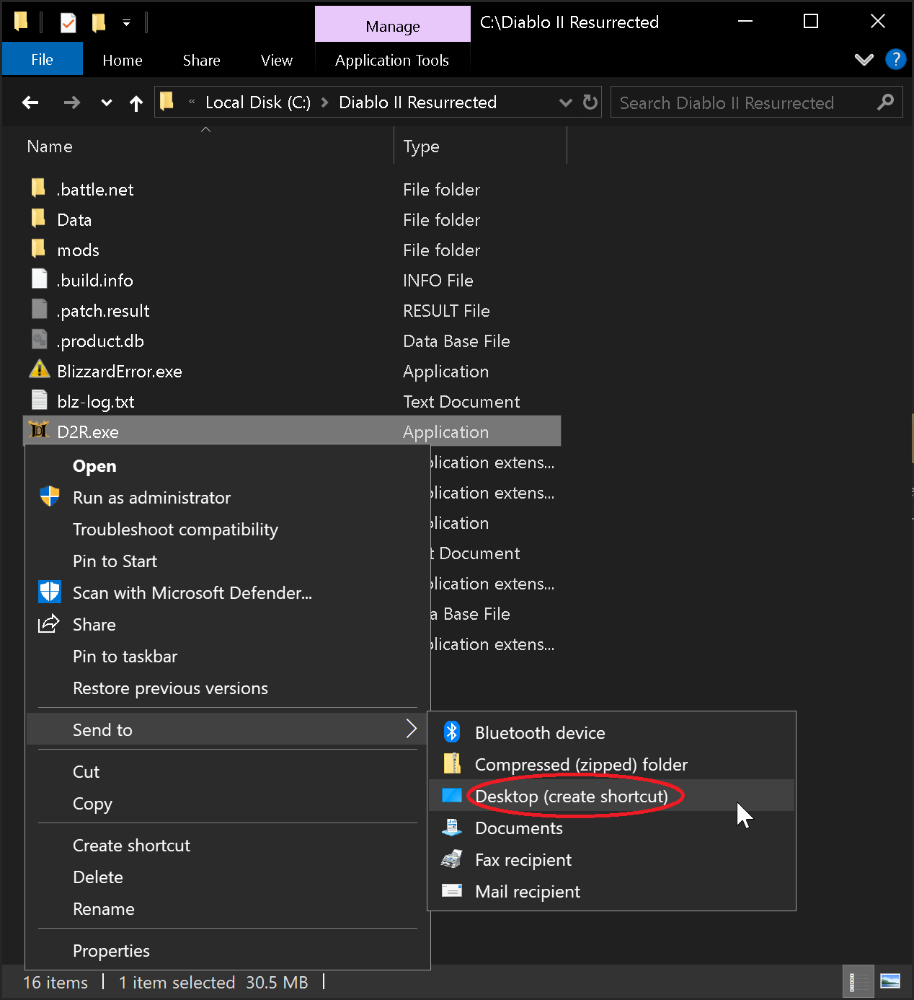
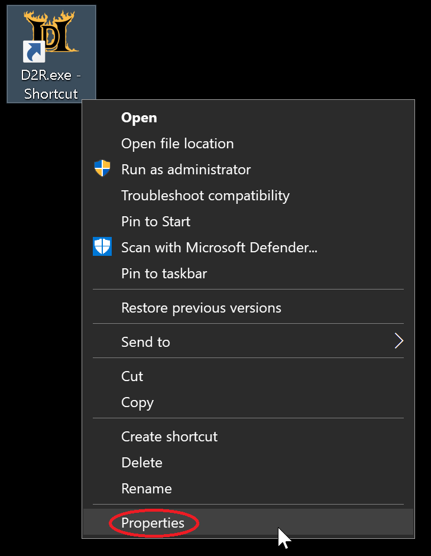
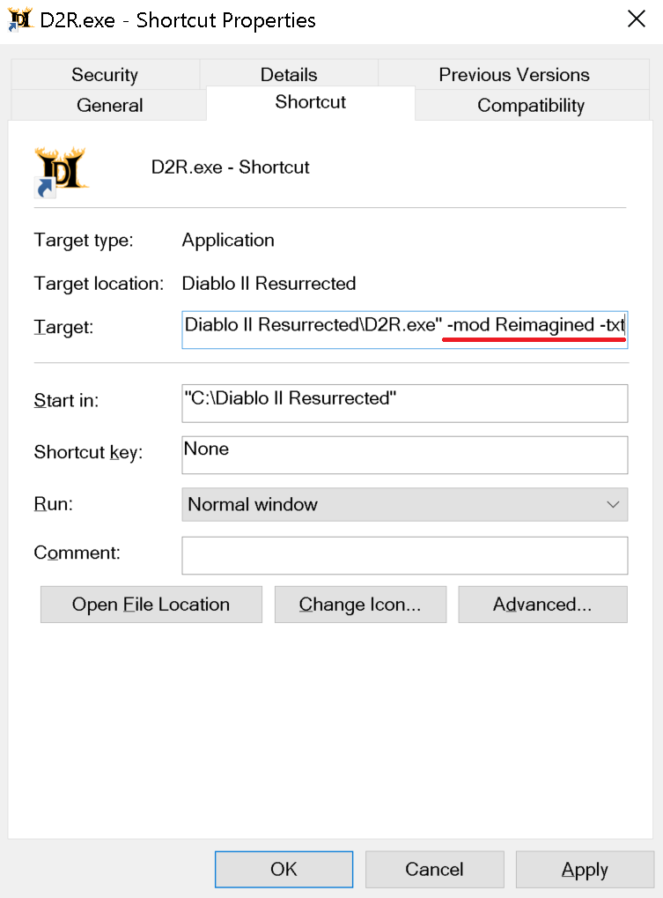

If you have not installed Diablo II Resurrected yet, depending on how you bought it you can first visit the [**Battlenet Game Installation Guide**](https://wiki.d2r-reimagined.com/InstallingDiablo2Battlenet) OR [**Steam Game Installation Guide**](https://wiki.d2r-reimagined.com/InstallingDiablo2Steam)

[Click here](https://wiki.d2r-reimagined.com/BattlenetSteam) to learn the differences between the Battle.net & Steam versions of the game Diablo II Resurrected.

## Use a Launcher or Manually Install Reimagined

**_Reimagined Launcher_** (Very Easy) Installs in Windows & automatically updates itself, available on [Nexus Mods](https://www.nexusmods.com/diablo2resurrected/mods/503?tab=files) OR the [Main Website HERE.](https://www.d2r-reimagined.com/download) With one-click it can find the latest version of Reimagined online too. Auto backup for your saved games.

**_Manually follow-the-steps_** (Easy/Hard): You will lookup your own installation directory & you'll be responsible for backing up your own saved games incase a crash occurs during a loading screen.

## Default File Locations - Depends if you bought on Battle.net App or Steam

> ***C: Drive is the most common install location. Yours may differ depending on your setup.  Launcher finds them automatically.***
> 
> **Battle.net D2R Mod Files:** `C:\Program Files (x86)\Diablo II Resurrected\mods\Reimagined`
> 
> **Steam D2R Mod Files:** `C:\Program Files (x86)\Steam\steamapps\common\Diablo II Resurrected\mods\Reimagined`
> 
> ***Saved Game Files:*** `*C:\Users\*%USERPROFILE%*\Saved Games\Diablo II Resurrected\mods\ReimaginedThree*`

## Reimagined Launcher

[**highly recommend watching Ben's video**](https://www.youtube.com/watch?v=GBQaLthlkAI). The installation process is very simple.

-   Download the launcher from the website [HERE](https://www.d2r-reimagined.com/download) or [Nexus Mods](https://www.nexusmods.com/diablo2resurrected/mods/503?tab=files)
-   Run the downloaded application (exe)
-   you now have installed the launcher

## Reimagined and D2RLoader

**Video instructions** [**HERE:**](https://youtu.be/FDJS0Sukpus)  
  
**D2RLoader** provides **LAN TCP/IP support** for Reimagined, including **Reign of the Warlock (ROTW)**, without the former class and mechanic restrictions.  
D2RLoader also allows for things like 100s of shared stash tabs, among other settings that can be found [here.](https://d2rloader.net/docs.html#settings)

> **notice:** D2RLoader is still in active development, so installation steps and configuration options may change in future updates.

> **Before you begin:** Everyone joining the same TCP/IP game must use **matching D2R, D2RLoader, D2RLoader Plugins/Patches, and Reimagined compatibility-build versions, as well as any Reimagined Launcher Tweaks or Plugins/alterations to files.**

### 1\. Have the Reimagined Launcher installed

-   Install the Reimagined Launcher, see the top of this page

Once installed you should see something like this where you have an option for offline or online


### 2\. Click Online and let the launcher install D2RLoader for you

-   Simply click the Online box which will check if D2RLoader is installed.
-   If D2RLoader is not installed the launcher will download and install it for you


-   Once D2RLoader is installed it will say it has completed


### 2.5\. Installing Ladder plugins for offline use

-   See [this subpage](/Installation/Nonladder) for instructions on installing ladder plugins

### 3\. Enable the Multiplayer widget

-   As of writing this, the multiplayer button widget is not automatically added to the UI of the mod (future launcher versions will handle this step)
-   So hit the “Start Online” button to launch the game with D2RLoader enabled
-   Once the game has started click the red cog at the bottom


-   Then enable the multiplayer button


-   At which point you will now see a multiplayer button which will allow you to host and browse games


### 4\. Hosting and Browsing games

-   To host simply create a game with whatever the desired details and rules are


-   To join a game go to browse and then join any open games or join your friends games with their game ID and password


-   if hosting an unlisted/private game, then the host needs to provide the game ID from the party menu.


-   And viola you are now playing reimagined on the latest mod version with rotw content with friends


### 4.5 Adjusting Shared Stash Tab Pages

-   The most frequent change you will want to make is to have more stash tabs. To do so, while at the main menu, hit the red cog at the botton of the character select screen to open up the D2RLoader settings
-   Then go to gameplay tab and adjust the shared stash tab pages and materials limit (ROTW tabs for runes/gems/materials)


-   Once done check in game and see your max shared stash tabs have been increased


### 5\. (optional legacy VPN setup) Set up Radmin VPN for LAN play

If you have issues with windows firewall or other network issues consider using radmin to setup a vpn

Download and install [**Radmin VPN**](https://www.radmin-vpn.com/), then turn it on.


Turn on Radmin VPN.

Open the **Network** menu. Create a private network for your group, or select **Join Network** to connect to an existing one.


Open the Network menu and select Create Network or Join Network.


Enter the network name and password.

**Example public network**

```plaintext
Network name: D2RR TCP/IPPassword:     DeckardLikesWine@69
```

Enter the details and click **Join**. Radmin VPN should display the shared network and its connected players.


Players connected to the same virtual network.

###   
  
  
**_If you have issues with the D2RLoader or other install, go to the Reimagined discord and post in the d2rr-installation-help or d2rr-online channels. Comments on the wiki are ignored._**

  
 

## Manual Reimagined Mod Installation

_Instructions to install the Reimagined mod manually without using any launchers or assistive programs._

Step 1. Download the latest Reimagined Mod version from [Nexus Mods](https://www.nexusmods.com/diablo2resurrected/mods/503?tab=files).



Step 2. Navigate to your [D2R Installation Directory](https://wiki.d2r-reimagined.com/en/Installs#file-locations) and at the top left click in the blank space and right click to highlight the game's path.  Then right click & click `Copy` as this information will be used in the step 4.  Next `open` the folder called "*mods*".  Your game's installed location will be different then in the picture.  



Step 3. Inside the mods folder check for a previous Reimagined folder & if present `delete` it since you're about to install a new version. (*right click, delete*)



Step 4. Navigate to where you just downloaded the mod, by default files typically go into your “*Downloads*” folder.  The new ZIP file that you just downloaded starts with the name: "D2R Reimagined" followed by a version number should be located here.  The picture below shows Reimagined version 3.0.5 as an example.



Step 5. Right click the ZIP file & click `Extract All` 



-   *Windows11 Users Click* `*Show More Options*` *to complete the above step.*



Step 6. On this next box that pops right click the pathway & click `Paste`.  Now the destination should be where you were earlier when you copied the path.  Again your location will be different then the one in the picture below.   Now click the `Extract` button and the Reimagined mod is now fully installed!



Step 7. Next we'll create a shortcut you can use to launch the mod.  Go back to your game's installation (from Step 2) & Right click on D2R.exe and click `Send to` and then `Desktop (Create Shortcut)`



-   *W11 Users Click* `*Show More Options*` *to complete the above step.*


-   Right click the shortcut on the desktop and select `Properties`



-   In the Target field, add the following to the end of the field:
    -   ` -mod Reimagined -txt`
    -   ` -mod Reimagined -txt -resetofflinemaps` *(_OPTIONAL:_ This will reset your maps everytime you visit the character select screen)*



-   **Make sure there's a space in-between D2R.exe" and -mod**
-   Click `Apply` and then `OK`

Step 6. You can rename the shortcut to anything and then Click or Double-Click the shortcut to play the mod.  Reimagined is now Installed and ready!

**If you wish to manually install any of the 6 Customization Tweaks (2skill, Forced Terror Zones, RemoveAuraSounds, HDR Fix, Letterbox removal, splashcharm graphic removal) those files are also included inside the Beta Launchers ZIP file towards the top of this page for players that are manually installing their game.  If you only want the 2Skill file, then just download the next file below instead.**

## D2RMM

Using a Mod Manager allows you to easily install a variety of mods together *(assuming they play nice)* without having to know anything about modding.

Reimagined is packed full of expansive features and QOL updates, so installing extra mods isn't always necessary. 

Check the list of [Reimagined features](https://wiki.d2r-reimagined.com/en/Installs#reimagined-features) below to see if a 3rd-party mod is still necessary.

When using D2RMM your active mod files will be now be located under the `**D2RMM\mods\**` folder instead of `**Diablo II Resurrected\mods\**`.

Any changes you make to Reimagined files needs to be done in the D2RMM mods directory.  
 

#### File Steps

1\. Download [D2RMM](https://github.com/olegbl/d2rmm/releases/tag/v1.9.2) from D2RMM Github.

2\. Open the `D2RMM` folder - navigate to the `mods` directory.

-   You should see a text file called 'PUT YOUR MODS HERE' - leave this window open, we'll use it later.

3\. Open a new File Explorer window and navigate to your `Reimagined` mod folder under your D2R Install directory.

4\. Copy the `Reimagined.mpq` folder (this should contain a Data folder and ModInfo.json).

5\. Paste the `Reimagined.mpq` folder into the `D2RMM/mods` folder from step 2.

-   We recommend renaming the folder to `Reimagined`

#### D2RMM Steps

6\. Open D2RMM as Administrator.

7\. Once open, click the three dots in the bottom-right corner and select 'Refresh Mod List'.

8\. Reimagined should appear in the mod list - click the box on the left-side to enable it.

> **The Reimagined folder must always be first in the list of mods. Click and drag the line to the top if it isn't.**

9\. Navigate to the Settings tab (at the top).

-   9a. Click on General.
    -   Change 'Output Mod Name' to 'Reimagined'.
    -   Toggle 'Automatically install mods before running the game'.
-   9b. Click on Game Launcher.
    -   Under 'Extra Game Args', paste the following: `-mod Reimagined -txt`
    -   Feel free to add any other args you want after everything else.

10\. Navigate back to the Mods tab.

11\. Click Install Mods.  
 

#### Play time!

12\. Hit 'Run D2R'.  
 

### Loot Filters

> **This guide assumes you have already downloaded and installed D2RMM (see above)**

-   **Because of the Warlock DLC we do recommend just using the in-game loot filtering system that is compatible with our treasure file, strings, and mod-added items.**
-   *For users without the DLC, the filter below and others like it on Nexus are use at your own risk and not supported by Reimagined. The mod changes every file each of the filters touches and authors would have to make a specific version for use with Reimagined for it to be fully compatible with no issues.*  
     

#### File Steps

1\. Download [Pseudo Loot Filter](https://www.nexusmods.com/diablo2resurrected/mods/467?tab=files) from Nexus Mods.

-   Select ‘Mod manager download’ to automatically download and load the mod into D2RMM.
-   Select ‘Manual download’ to download the mod to your `Downloads` folder - extract the mod into your `D2RMM/mods` folder.  
     

#### D2RMM Steps

2\. In D2RMM, click the 3 dots in the bottom-right, and select ‘Refresh Mod List’.

3\. You should now see Pseudo Loot Filter appear in the list of mods - click the box to the left to enable the mod.

4\. To configure the loot filter, click ‘settings’ to the right.

5\. All items are enabled by default (the slider is on the right-side) - clicking the slider DISABLES the item (this affects all rarities, white, magic, rare, set, unique).

-   Disabling an item simply means that when a disabled item would drop, the game chooses to drop nothing instead.
-   Disabling items does not affect drop chances of other items.
-   It may take a few runs to tweak this list to your liking.

6\. Once you've finished disabling undesirable items, click out of the menu.

7\. Click ‘Install Mods’ in the bottom-right.

8\. Hit ‘Run D2R’.

####   
D2RMM FAQ:

My mod isn't showing up in the mod list on D2RMM?

-   You didn't put the mod in D2RMM/mods, you didn't unzip the file you downloaded, or it's in a folder that D2RMM doesn't understand
-   Run D2RMM as administrator

DM on discord if you need further instructions/help

### Reimagined Features:

If you have questions about whether something is included in Reimagined, or would like to see something added, DM one of the Devs, or post in the suggestions-and-feedback channel of our discord channel.

A number of Mod Creators gave express permission to include their mod in Reimagined. Where this is the case credit is given on the [Reimagined Nexus Mods](https://www.nexusmods.com/diablo2resurrected/mods/503?tab=description) page.

The below (non-exhaustive) list of mods are already functionally covered in Reimagined in some form:

**New Content**

-   Completely reimagined Hell Difficulty

**Inventory**

-   Expanded Inventory / Stash / Cube

**Items**

-   Increase Drop Rates (for all items, runes, gems, etc.)
-   Sunder Charms (dropped by Bosses, super uniques, etc.)
    -   sunders drop in nightmare and hell terror zones
-   Melee AOE Small Charm (Collin's Charm)
-   Perfect Gem Drops / Short Gem Names (there is only one type of Gem in Reimagined)

**Systems**

-   Item Enchants
-   Horadric Forging (various cube recipes allow rerolling, crafting, etc.)
-   Corruptions (implemented via Orb of Corruption)
-   Socket Punching
-   Stackable Runes & Gems (runes drop as stacks; gems are collected in a bag)
-   Rune Easy Upgrade / Downgrade (tooltip printed on rune stacks)

**Mercenaries**

-   Expanded Merc Equipment (all equip slots useable for mercs)

**QOL**

-   Show Item Level
-   Show Item Quality (all items contain \[N\], \[X\], \[E\] tags to show quality)
-   Numbered Rune Names
-   Better Rune Visibility (runes already named, numbered and colored for easier visual identification)
-   Light Pillars (used on various important items)
-   Short Potion Names (renamed already to HP1, MP1, etc.)
-   Town Cast
-   Token of Absolution (sold by Potion Vendors)
-   Short Scroll Names (renamed to TP and ID)
-   Move Cain and Teleports (characters always start in center of town, Cain is there too)
-   Breakpoints and Recipes panels (already included in various forms in-game)
-   Terror Zones (TZs span entire acts for an hour already, no need to pick them)

**Monsters**

-   Monster Density (density custom-set in every area already)
-   Many new super unique monsters

**Environment / UI**

-   Diablood
-   Skill Icons (all skills have been colorised and textured for each class, including Mercs)

## Crashing Frequently? Tips to Troubleshoot

Here are some common resolutions to frequent crashing we've encountered in bug reports across the Discord, Nexus and Reddit.

1\. Reimagined 3.0+ is not compatible with saves from Reimagined 1.x.x, Reimagined 2.x.x, D2R vanilla, or other mods if the save file contains items. Trying to place them in the saves folder and use them will often cause the game to crash.

2\. Classic characters cannot be created and are incompatible with the mod.

3\. Change graphics option VFX Lighting Quality off from Ultra to High or Medium as it barely has any visual impact but kills game performance and causes crashing.

4\. Cap your framerate to your monitors refresh rate and/or use Vsync.

5\. Don't Alt + Tab, *(click out of the screen if playing in windowed)* the game doesn't enjoy being out of focus. You can try to mitigate this crash by limiting the Background FPS of D2R.exe via your GPU Control Panel. *(The game still likes to crash anyways but the background FPS limit helps reduce the frequency.)*

6\. Don't equip items on Mercs with Chance to Cast a minion. *(Reanimate is fine, it is specifically CTC that seems to cause issues.)*

7\. Change Power Settings from Performance to Balanced *(Unintuitive but seems to work for some people.)*

8\. If you are using other mods, you can try disabling them to see if the crashes continue but if they edit itemstatcost.txt then disabling them will cause crashes anyways so pay attention to what you are doing and make backups before experimenting.

9\. If you are making local mod edits, undo those edits or reinstall the mod fresh.