If you have not installed Diablo II Resurrected yet, depending on how you bought it you can first visit the [**Battlenet Game Installation Guide**](https://wiki.d2r-reimagined.com/InstallingDiablo2Battlenet) OR [**Steam Game Installation Guide**](https://wiki.d2r-reimagined.com/InstallingDiablo2Steam)

[Click here](https://wiki.d2r-reimagined.com/BattlenetSteam) to learn the differences between the Battle.net & Steam versions of the game Diablo II Resurrected.

# Use a Launcher or Manually Install Reimagined

**_Reimagined Launcher_** (Very Easy) Installs in Windows & automatically updates itself, available on [Nexus Mods](https://www.nexusmods.com/diablo2resurrected/mods/503?tab=files) OR the [Main Website HERE.](https://www.d2r-reimagined.com/download) With one-click it can find the latest version of Reimagined online too. Auto backup for your saved games.

**_Manually follow-the-steps_** (Easy/Hard): You will lookup your own installation directory & you'll be responsible for backing up your own saved games incase a crash occurs during a loading screen.

## Default File Locations - Depends if you bought on Battle.net App or Steam

> ***C: Drive is the most common install location. Yours may differ depending on your setup.  Launcher finds them automatically.***
> 
> **Battle.net D2R Mod Files:** `C:\Program Files (x86)\Diablo II Resurrected\mods\Reimagined`
> 
> **Steam D2R Mod Files:** `C:\Program Files (x86)\Steam\steamapps\common\Diablo II Resurrected\mods\Reimagined`
> 
> ***Saved Game Files:*** `*C:\Users\*%USERPROFILE%*\Saved Games\Diablo II Resurrected\mods\ReimaginedThree*`

## Reimagined Launcher

[**Highly recommend watching Ben's video**](https://www.youtube.com/watch?v=GBQaLthlkAI). The installation process is very simple.

-   Download the launcher from the [Reimagined website](https://www.d2r-reimagined.com/download) or [Nexus Mods](https://www.nexusmods.com/diablo2resurrected/mods/503?tab=files)

<a href="https://www.d2r-reimagined.com/download" class="wiki-button">Reimagined Website</a> <a href="https://www.nexusmods.com/diablo2resurrected/mods/503?tab=files" class="wiki-button" style="background-color:green">Nexus Mods</a>
-   Run the downloaded application (exe)
-   You now have installed the launcher

## Reimagined and D2RLoader

**Video instructions** [**HERE:**](https://youtu.be/FDJS0Sukpus)  
  
**D2RLoader** provides **LAN TCP/IP support** for Reimagined, including **Reign of the Warlock (ROTW)**, without the former class and mechanic restrictions.  
D2RLoader also allows for things like 100s of shared stash tabs, among other settings that can be found [here.](https://d2rloader.net/docs.html#settings)

> D2RLoader is still in active development, so installation steps and configuration options may change in future updates.
{.is-warning}

> **Before you begin:** Everyone joining the same TCP/IP game must use **matching D2R, D2RLoader, D2RLoader Plugins/Patches, and Reimagined compatibility-build versions, as well as any Reimagined Launcher Tweaks or Plugins/alterations to files.**

### 1\. Have the Reimagined Launcher installed

-   Install the Reimagined Launcher, see the top of this page

Once installed you should see something like this where you have an option for offline or online

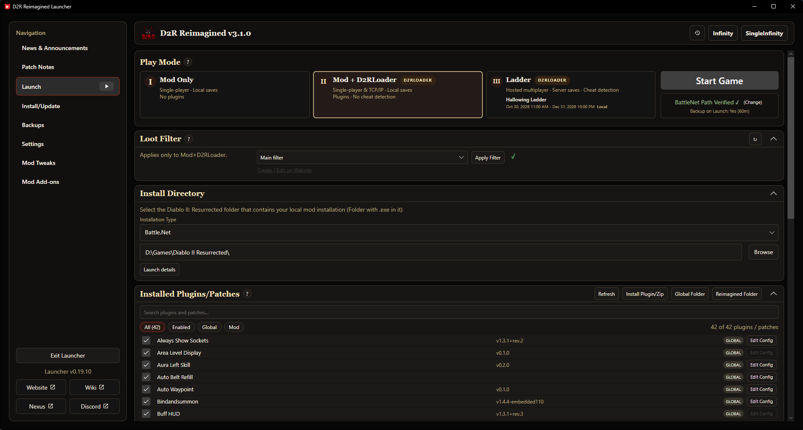

### 2\. Click Online and let the launcher install D2RLoader for you

-   Simply click the Online box which will check if D2RLoader is installed.
-   If D2RLoader is not installed the launcher will download and install it for you

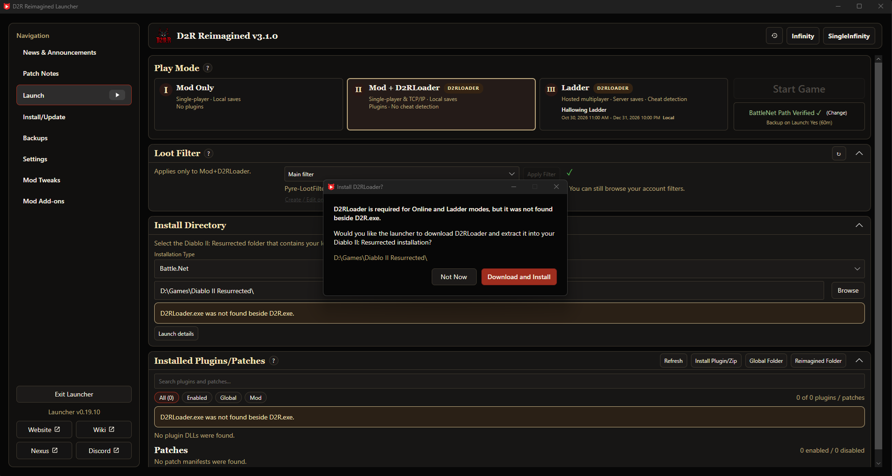

-   Once D2RLoader is installed it will say it has completed

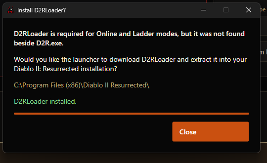

### 3\. Installing Ladder plugins for offline use (Optional)

-   See this subpage for instructions on installing ladder plugins

<a href="/Installation/Nonladder" class="wiki-button">Ladder Bundle Installation</a>

### 4\. Enable the Multiplayer widget (Optional)

-   As of writing this, the multiplayer button widget is not automatically added to the UI of the mod (future launcher versions will handle this step)
-   So hit the “Start Online” button to launch the game with D2RLoader enabled
-   Once the game has started click the red cog at the bottom

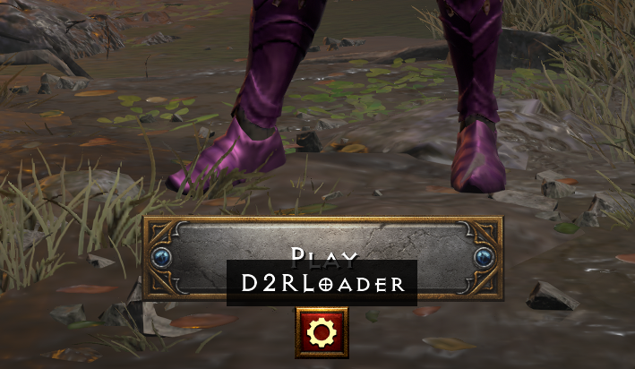

-   Then enable the multiplayer button

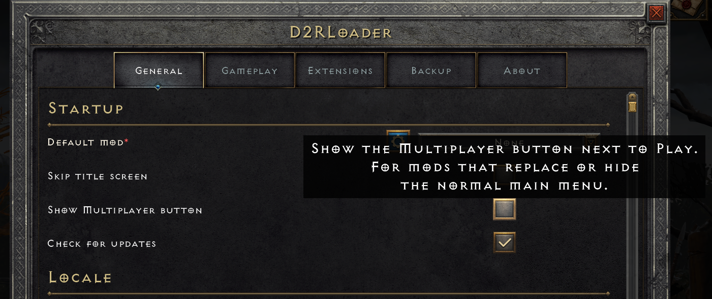

-   At which point you will now see a multiplayer button which will allow you to host and browse games

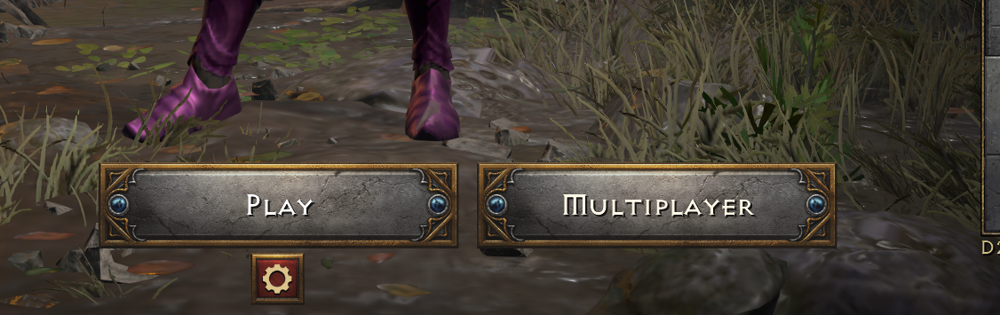

### 4\.5\. Hosting and Browsing games  (Optional)

-   To host simply create a game with whatever the desired details and rules are

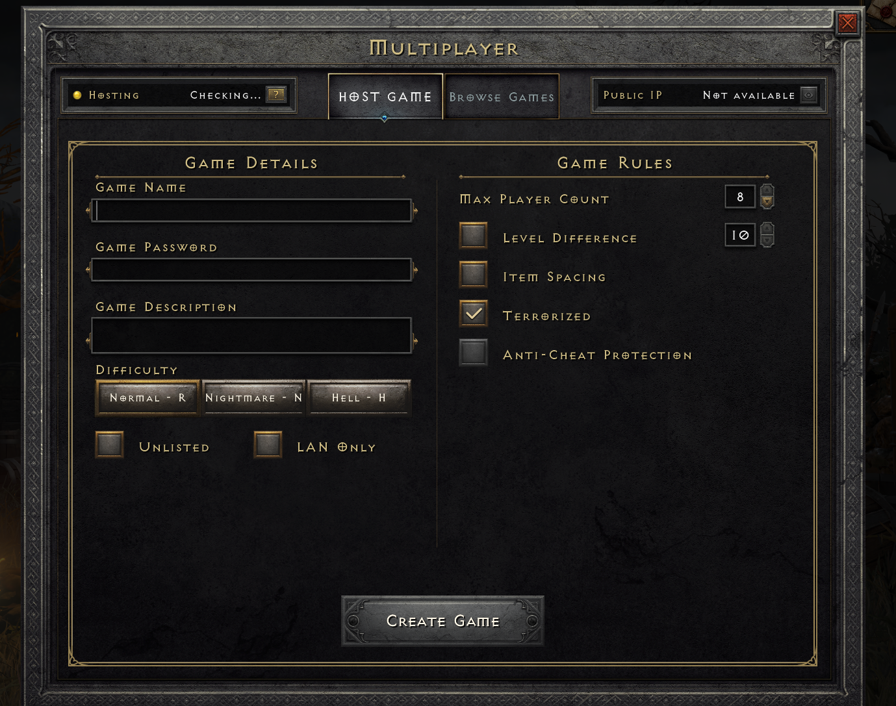

-   To join a game go to browse and then join any open games or join your friends games with their game ID and password

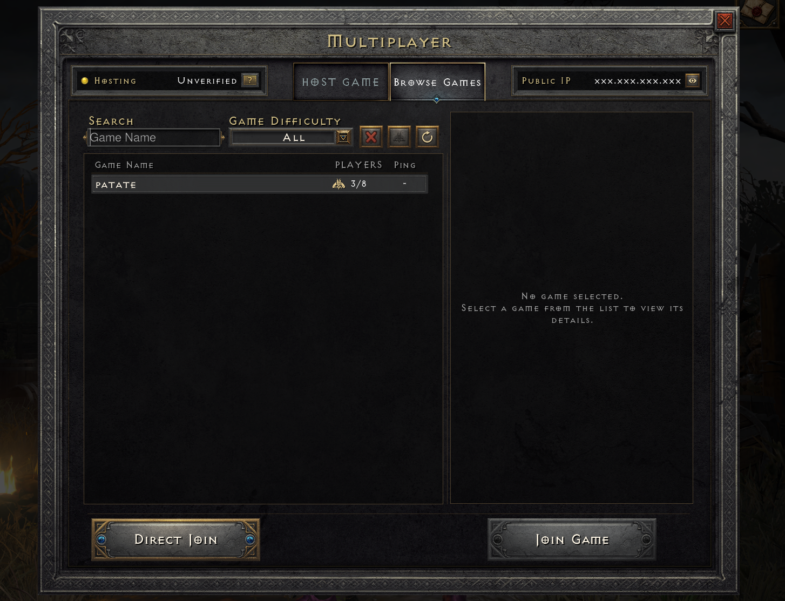

-   if hosting an unlisted/private game, then the host needs to provide the game ID from the party menu.

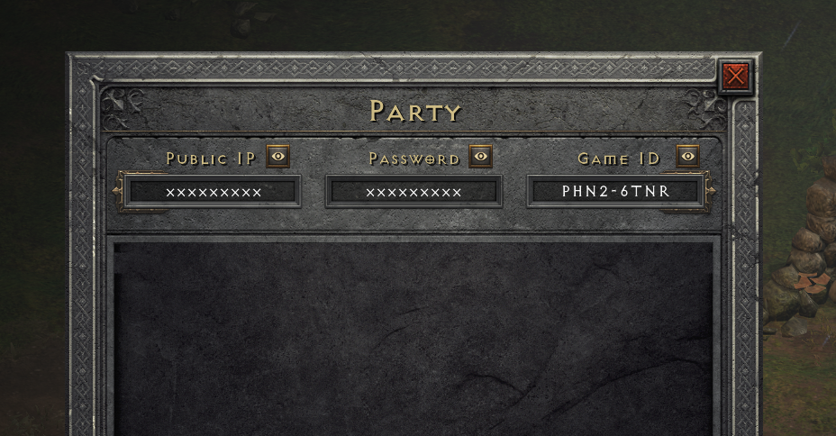

-   And viola you are now playing reimagined on the latest mod version with rotw content with friends

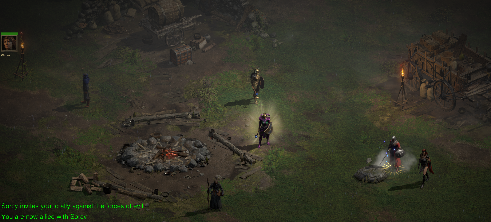

### 5\. Adjusting Shared Stash Tab Pages

-   The most frequent change you will want to make is to have more stash tabs. To do so, while at the main menu, hit the red cog at the botton of the character select screen to open up the D2RLoader settings
-   Then go to gameplay tab and adjust the shared stash tab pages and materials limit (ROTW tabs for runes/gems/materials)

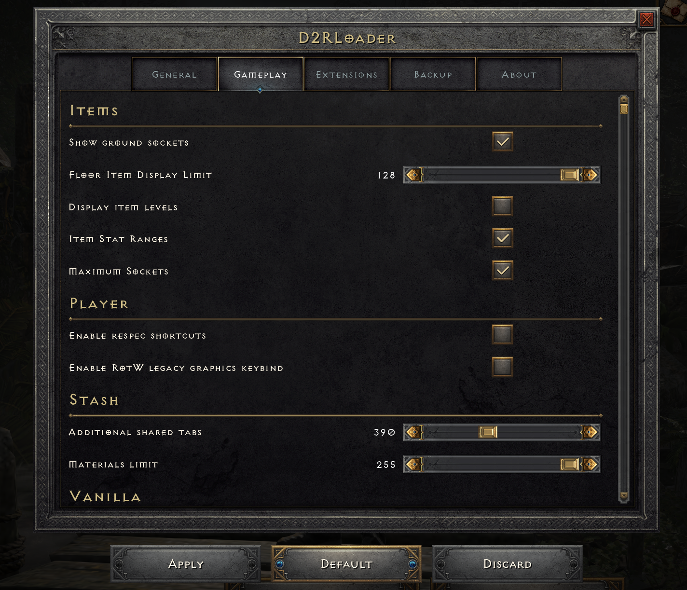

-   Once done check in game and see your max shared stash tabs have been increased

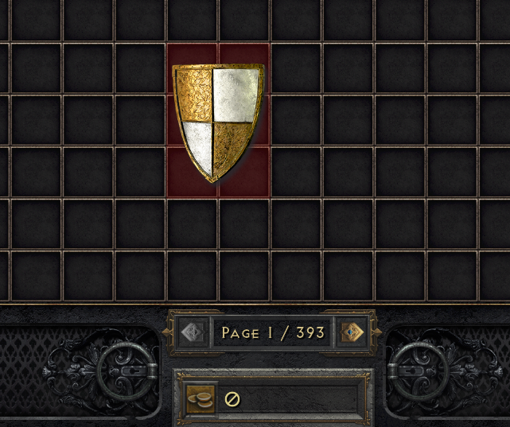

### 6\. Legacy VPN set up - Radmin VPN for LAN play (Optional)

-   See this subpage for instructions on installing ladder plugins

<a href="/Installation/VPN" class="wiki-button">VPN Setup</a>

---
>If you have issues with the D2RLoader or other installation instructions, visit the [Reimagined discord](https://discord.com/channels/898562996715012096/904512913136570419) for assistance. Comments on the wiki are ignored.
{.is-warning}

## Alternate Install Methods

## Manual Reimagined Mod Installation

- See this subpage for instructions on installing Reimagined without a launcher or mod manager

<a href="/Installation/Manual" class="wiki-button">Manual Installation</a>

## D2RMM

- See this subpage for instructions on installing with D2RMM

<a href="/Installation/D2RMM" class="wiki-button">D2RMM Installation</a>

## Crashing Frequently? Tips to Troubleshoot

Here are some common resolutions to frequent crashing we've encountered in bug reports across the Discord, Nexus and Reddit.

1\. Reimagined 3.0+ is not compatible with saves from Reimagined 1.x.x, Reimagined 2.x.x, D2R vanilla, or other mods if the save file contains items. Trying to place them in the saves folder and use them will often cause the game to crash.

2\. Classic characters cannot be created and are incompatible with the mod.

3\. Change graphics option VFX Lighting Quality off from Ultra to High or Medium as it barely has any visual impact but kills game performance and causes crashing.

4\. Cap your framerate to your monitors refresh rate and/or use Vsync.

5\. Don't Alt + Tab, *(click out of the screen if playing in windowed)* the game doesn't enjoy being out of focus. You can try to mitigate this crash by limiting the Background FPS of D2R.exe via your GPU Control Panel. *(The game still likes to crash anyways but the background FPS limit helps reduce the frequency.)*

6\. Don't equip items on Mercs with Chance to Cast a minion. *(Reanimate is fine, it is specifically CTC that seems to cause issues.)*

7\. Change Power Settings from Performance to Balanced *(Unintuitive but seems to work for some people.)*

8\. If you are using other mods, you can try disabling them to see if the crashes continue but if they edit itemstatcost.txt then disabling them will cause crashes anyways so pay attention to what you are doing and make backups before experimenting.

9\. If you are making local mod edits, undo those edits or reinstall the mod fresh.