# The Forsaken Labyrinth

The Forsaken Labyrinth is a Hell-only difficulty endgame dungeon beyond Harrogath. It is a connected descent through five boss domains, with each area increasing in difficulty from level 104 to 110. Expect a heavy mix of undead enemies, dangerous spellcasters, summoned reinforcements, and boss fights that punish careless play.

To enter, you need a Forsaken Token. This can be obtained from Hell Baal's quest reward or from Hell Corpsefire after defeating Hell Baal. You then transmute the token in Harrogath to open the gate to the dungeon, and the token is returned so it can be used again.

> It is highly recommended to only enter this dungeon once you are very confident your build is strong enough to survive high damage and deal high damage. 

> If you are unprepared farm terror zones, and maps.

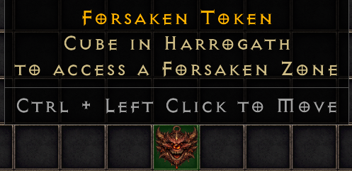

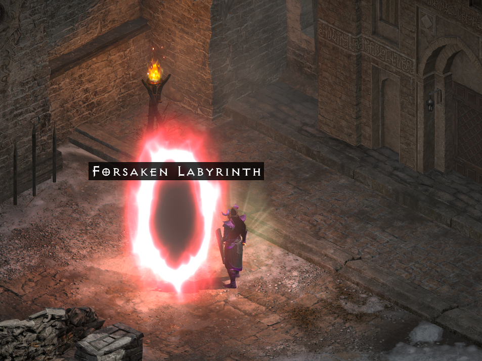

## Rewards and progression

The Labyrinth is designed around long-term progression and endgame rewards. It introduces six new runes, high-tier gear, crafting materials, and the Relic of the Ancients. The relic is a level-80 unique Grand Charm with +1 to a random class skill, increased maximum life and mana, Magic Find, and Gold Find. It also tracks boss progression from each clear.

The relic starts as a fresh drop and can be upgraded with a Shadow Orb and the correct rune. Each upgrade increases the skill level for the class performing the recipe and grants a bonus such as more life, resistances, or a defensive stat.

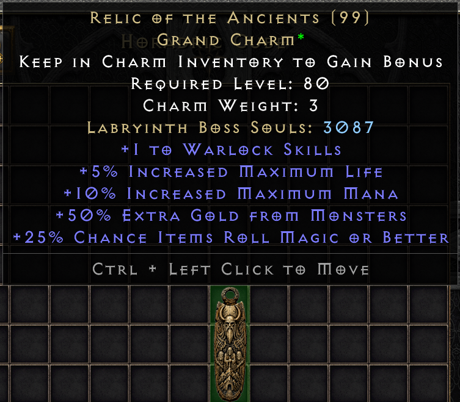

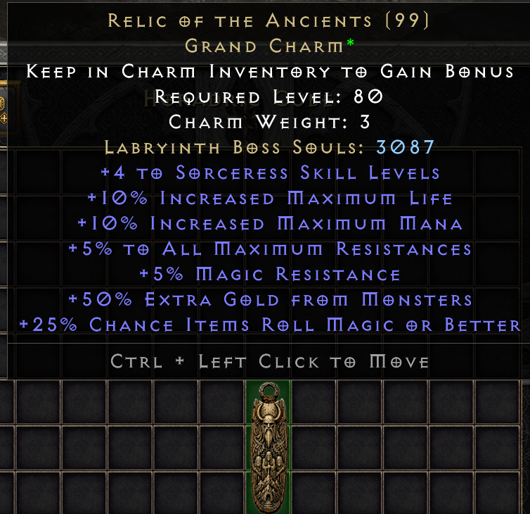

## Entrance area and waypoint

The Labyrinth also adds a new staging area near the entrance, including the waypoint that can be unlocked for easier access. This gives players a safe place to prepare before heading back into the dungeon.

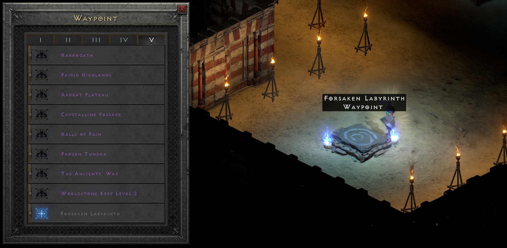

## Lore and guidance

Ord Rekar, the Lorekeeper of the Ancients, can be found at the entrance and is the best place to learn about the Labyrinth, its purpose, and the rewards waiting beyond.

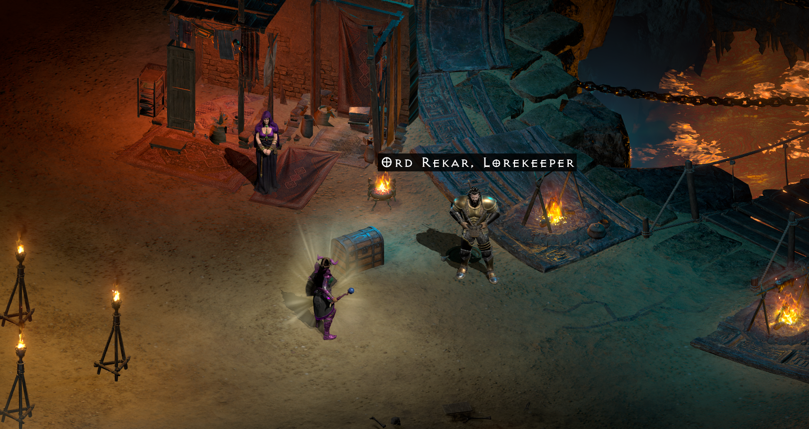

## New runes (R34-R39)

The Labyrinth adds six new runes in order from R34 to R39: Brak, Zeph, Myr, Grit, Dem, and Hev. These are DROP ONLY and cannot be uptiered or downtiered.

These runes provide additional socketing and crafting options while also feeding into the Labyrinth's new equipment and upgrade systems. The dungeon is meant to be a major endgame progression step, with its rewards and progression tied directly to clearing the boss domains and upgrading the relic.

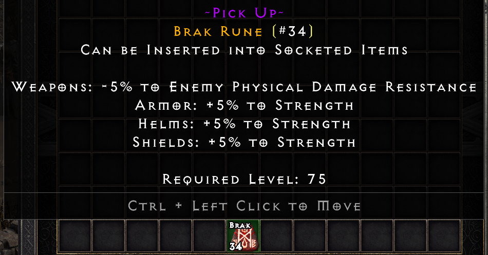 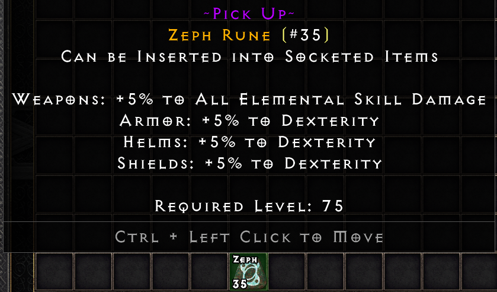 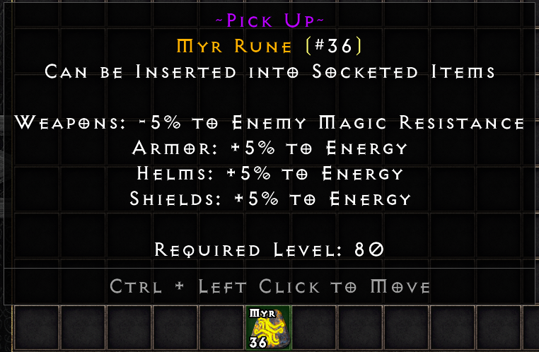

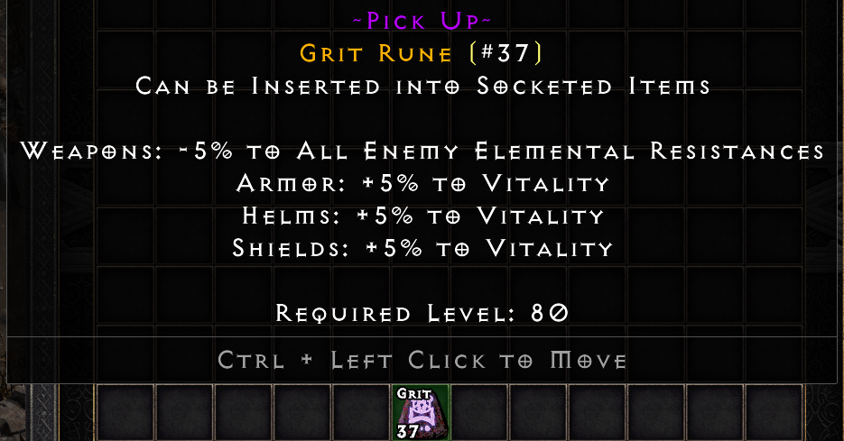 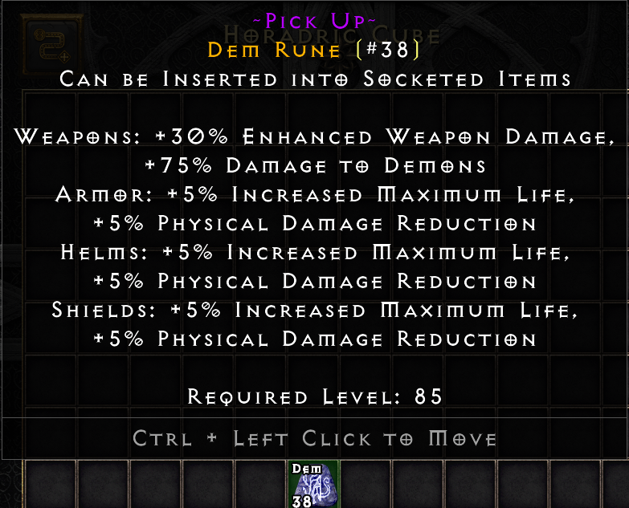 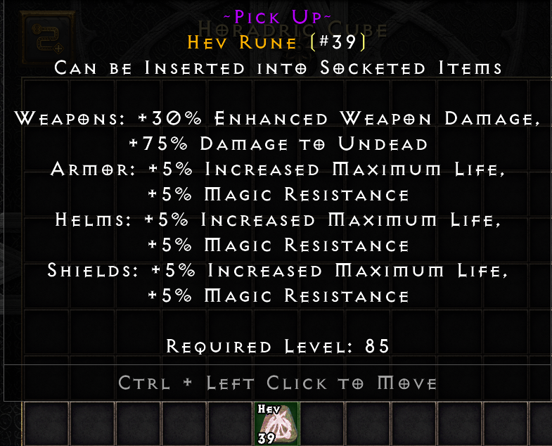

